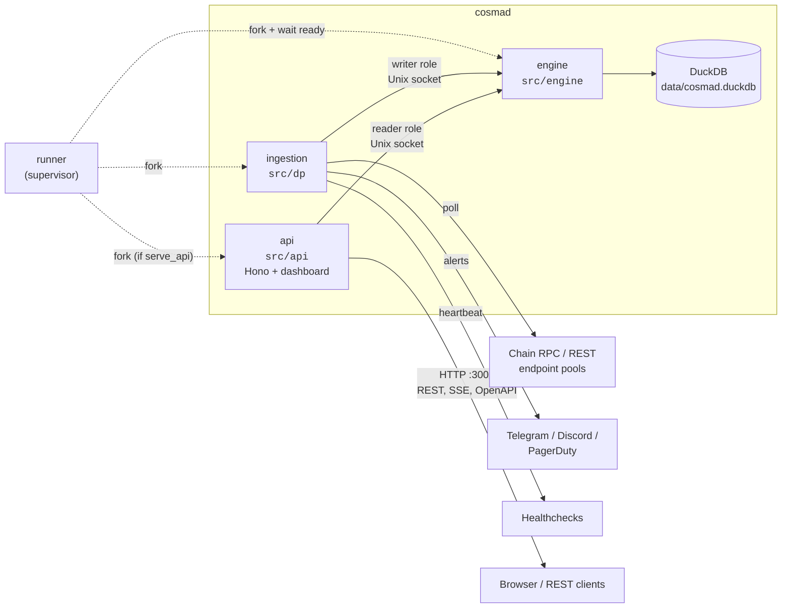
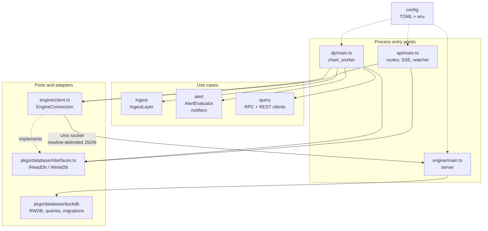
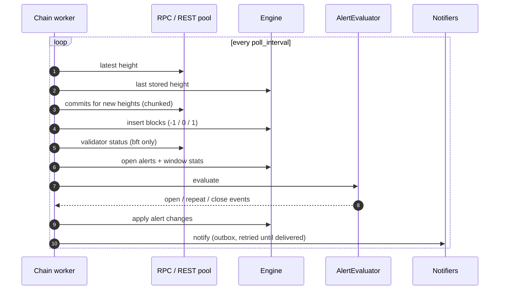
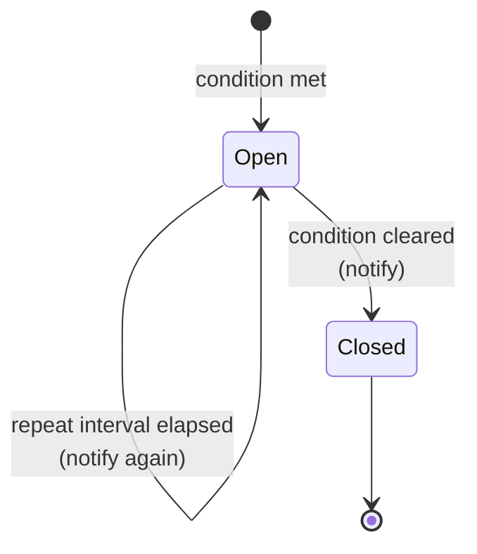
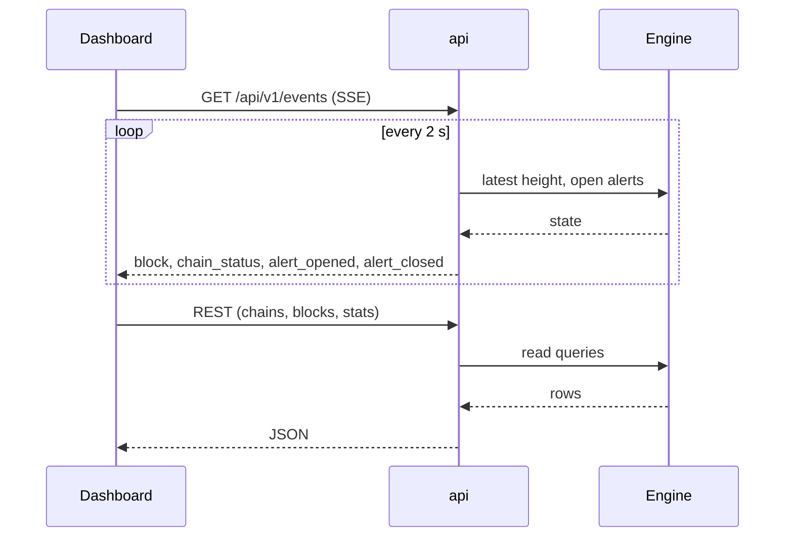

# How it works

## Processes

`dist/runner.js` is a supervisor that forks three child processes and waits for
each to report ready before starting the next:

| Process   | Source       | Role                                                                              |
| --------- | ------------ | --------------------------------------------------------------------------------- |
| engine    | `src/engine` | The only process that opens the DuckDB file. Serves reads/writes over a socket    |
| ingestion | `src/dp`     | One worker per chain: polls, stores blocks, evaluates alerts, sends notifications |
| api       | `src/api`    | Hono HTTP server: REST API, SSE stream, OpenAPI docs, static dashboard            |

DuckDB allows only one read-write process per database file, which is why
the engine exists: the other processes connect to it with a role (`writer` / `reader`)
and the API **can never write**(at least for now).
If any child exits unexpectedly the runner terminates the rest and exits non-zero,
so a service manager restarts the whole thing. On start the runner also kills a
leftover engine from a crashed run (tracked in `data/engine.pid`).

If `serve_api = false` the API process is not started at all.

## Code layout

Dependencies point inward: processes depend on the `IReadDb` / `IWriteDb`
interfaces, never on a concrete database class. The engine client is just
another implementation of those interfaces, over a socket.

## Ingestion, per chain

1. **Poll** the RPC every `poll_interval` (default 6s). New heights are fetched in chunks
   (`range_chunk_size`, default 25 concurrent commit requests) and at most `max_blocks_per_poll`
   (default 100) are ingested per cycle, so a large gap after downtime is worked off gradually.
2. **Record** each block as one row for your validator:
   `-1` not in the active set, `0` active but missed, `1` signed.
   Cosmad only sees commits, so prevote/precommit detail is not available.
3. **Resolve validator status** (bft only) from the staking and slashing REST endpoints: bonded,
   jailed (with jail end), tombstoned.
4. **Health check** every configured RPC/API endpoint every `health_check_interval` seconds (default 60).
5. **Evaluate alerts** and dispatch notifications.

Several RPC/API URLs per chain are treated as a pool: unhealthy ones are skipped, so one failing
endpoint doesn't stop monitoring and load is spread on rate-limited public nodes. After a restart,
ingestion resumes from the last stored height.

## Alert lifecycle

Alerts are rows in the database with an open and (eventually) closes. For each type, at most one
alert is open at a time. It is **opened**, optionally **repeated**, then **closed** when the
condition clears. Notifications are sent on each of those events.

| Alert type                           | Raised when                                                                                                   |
| ------------------------------------ | ------------------------------------------------------------------------------------------------------------- |
| `stalled`                            | The chain tip (from RPC) is older than `stalled_threshold` seconds                                            |
| `consecutive_miss`                   | The validator missed `threshold` blocks in a row                                                              |
| `percentage_miss`                    | Missed share of the sliding signing window exceeds `threshold` percent                                        |
| `inactive` / `jailed` / `tombstoned` | Validator is outside the active set (at most one open)                                                        |
| `rpc_down` / `api_down`              | An endpoint with `alert_if_down = true` stays unhealthy for `endpoint_down_alert_after` seconds (default 180) |

The signing window comes from the chain (`signed_blocks_window` via
`/cosmos/slashing/v1beta1/params`) for `bft` chains; `tm2` chains default to
10 000 unless `signing_window_size` is set. Endpoint-down grace periods are in
memory only: after a restart the timer starts over,
but alerts that were already open stay open until the endpoint recovers.

Notifications are stored in an outbox table first. A failed send is tried 3 times, then retried
after a pause that doubles each round (default 5 min up to 1 h) until it succeeds, also across
restarts. See [notifications](notifications.md#delivery-and-retries). Telegram, Discord and PagerDuty are all
used when enabled. Healthchecks is a separate heartbeat, see [notifications](notifications.md).

## Storage

One DuckDB file, `<DB_DIRECTORY>/cosmad.duckdb`, shared by all chains (rows are partitioned by
`chain_id`). Tables: blocks, alerts, validator inactivity, notification outbox and the schema version (`cosmad_version`). Schema changes are applied
automatically on start via additive column migrations. There is no pruning yet; the database grows
with chain block count, so plan disk accordingly and see [operations](operations.md#backups).

### Live updates

The API process polls the engine every 2 s and pushes changes to the dashboard over SSE.

## Chain types

|                | `bft` (Cosmos SDK / CometBFT)                    | `tm2` (Gnoland / TM2)                  |
| -------------- | ------------------------------------------------ | -------------------------------------- |
| Address fields | `valoper_address`, `valcons_address` (bech32)    | `operator_address`, `signing_address`  |
| `api_urls`     | **required** (validator status, slashing params) | not used                               |
| Status alerts  | inactive, jailed, tombstoned                     | not available*                         |
| Signing window | from chain                                       | `signing_window_size`, default 10 000* |

*For `tm2` chains it is kinda possible, but it is also a bit harder. It requires
monitoring the `gnops` and tracking votes on validator being removed from the
chian. It would require a data processor alone that would track these kind of
changes. Although this might change in the future for now if the validator is
removed from the active set it will count as missed block.
The signing window size is non existent on Gnoland, not like the Cosmos chains
have. So this is more for limiting it to some scope so the script can work.
